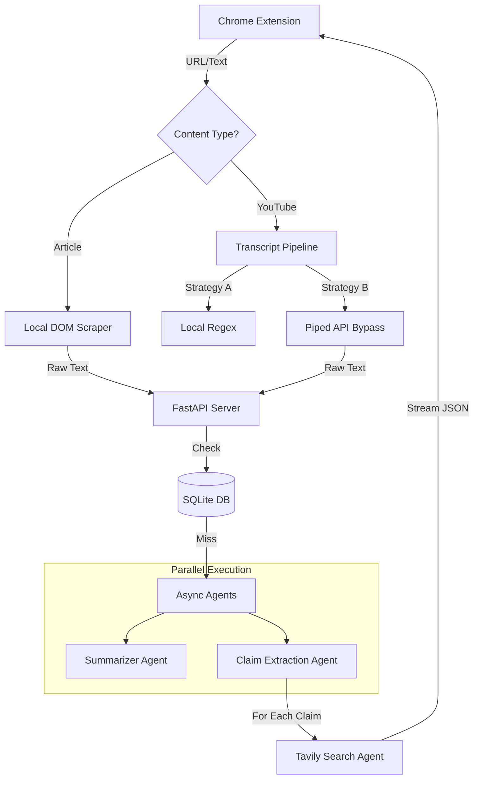

# 🧠 Dialectic Engine
> **An AI-powered "Bullshit Detector" for the modern web.**
> *Instantly extracts, verifies, and counter-argues claims from Articles and YouTube Videos.*

[](https://www.python.org/)
[](https://fastapi.tiangolo.com/)
[](https://openai.com/)
[](LICENSE)

---

## 🎥 Demo

<video src="https://github.com/user-attachments/assets/6deac345-ce4d-4ae3-a54b-8863cce51f46" controls="controls" style="max-width: 100%;">
</video>

---

## 🚀 Overview
Dialectic Engine is a Chrome Extension + FastAPI backend designed to combat echo chambers.
Unlike basic summarizers, it seeks **argumentative claims** and uses autonomous AI agents to find **contradictory evidence** in real time.

**Features:**
- Handles **articles**, **blogs**, **YouTube videos**, and **Shorts**
- Works even with **auto-generated or foreign-language captions**
- Runs a **parallelized agentic workflow** for ultra-low latency

---

## ✨ Key Features

- 🕷️ **Multimodal Analysis** — Works across text & video platforms
- ⚡ **Real-Time Streaming** — SSE gives 0.5s time-to-first-byte
- 🛡️ **Anti-Blocking Transcript Extraction** — Multi-layer fallback
- 🧠 **Argument-Focused Filtering** — Extracts only *debatable* claims
- 💸 **Cost Efficient** — SQLite caching reduces API usage

---

## 🏗️ Architecture



## 🛠️ Tech Stack

### Frontend
* **Chrome Extension** (Manifest V3)
* **Vanilla JavaScript**
* **Server-Sent Events (SSE)**

### Backend
* **Python**, **FastAPI**, **Uvicorn**
* **OpenAI GPT-4o-mini**
* **Tavily Search API**
* **SQLite** (Local Caching)

### Deployment
* **Dockerized backend** deployed on Render

---

## ⚡ Installation (Local Development)

### 1️⃣ Clone the Repository
```bash
git clone [https://github.com/Harshit-Negi27/dialectic-engine.git](https://github.com/Harshit-Negi27/dialectic-engine.git)
cd dialectic-engine
```

### 2️⃣ Backend Setup
```bash
# Create virtual environment
python -m venv venv
source venv/bin/activate      # Windows: venv\Scripts\activate

# Install dependencies
pip install -r backend/requirements.txt
```

**Create a `.env` file in `/backend`:**
```ini
OPENAI_API_KEY=sk-...
TAVILY_API_KEY=tvly-...
```

### 3️⃣ Run the Server
```bash
uvicorn backend.main:app --reload
```
### 🌐 Server URLs

- **Local Development:** http://127.0.0.1:8000  
- **Production (Render):** https://dialectic-engine.onrender.com

### 4️⃣ Load the Chrome Extension
1. Open `chrome://extensions`
2. Enable **Developer Mode**
3. Click **Load unpacked**
4. Select the `extension/` folder

---

## 🧩 Engineering Challenges Solved

### 🚧 The YouTube Block Problem
**Problem:** YouTube blocks data-center IPs (Render/AWS).
**Solution:** Implemented client-side transcript extraction + **Piped API fallback** to bypass blocks entirely.

### ⚙️ Concurrency Optimization
**Result:** Latency reduced from **20s → ~10s**.
**Solution:** Switched to `asyncio.gather`, parallel agent execution, and **Streaming responses**.

### 🔍 DOM State Management
**Problem:** YouTube removes `ytInitialPlayerResponse` from the DOM.
**Solution:** Injected a **“Spy Script”** to capture ephemeral JS variables before they vanish.

---

## 🔮 Future Roadmap
- [ ] Add **Chat Mode** using OpenAI Agents SDK
- [ ] Add **Whisper audio pipeline** (Reels/TikTok)
- [ ] Add **User Accounts** + multi-device sync

---

## 🤝 Contributing
PRs and Issues are welcome!
If you like this project, consider starring ⭐ the repo.

## 👤 Built by
**Harshit Negi**
